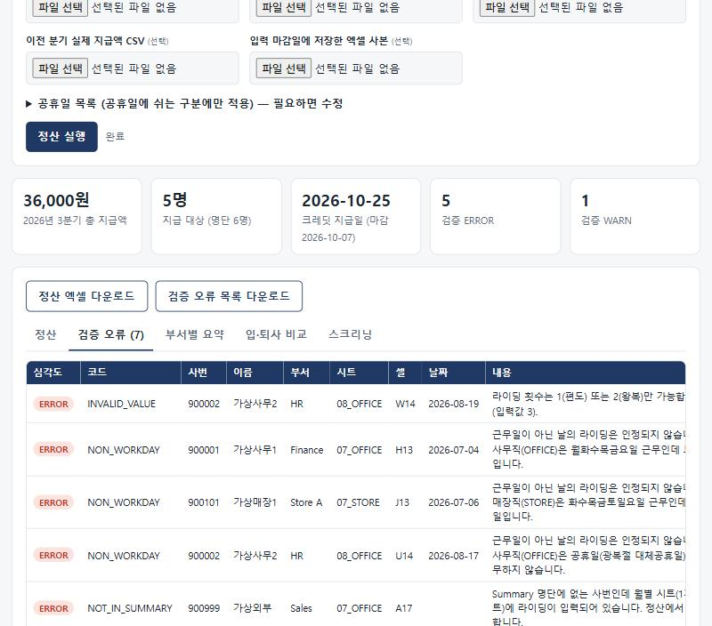

# bike-commute-credit

자전거 출퇴근 복지(라이딩 1회당 크레딧) **분기 정산을 자동화**하는 작은 도구입니다. 엑셀로 입력받는 제도를 가정하고, 규칙 검증 → 스크리닝 → 정산까지 한 번에 처리합니다. Claude Code 스킬(Python)과 설치 없이 쓰는 웹 도구(HTML 한 파일)를 함께 담았습니다.

> *English summary:* A small tool that automates quarterly settlement of a bike-commute benefit (credit per ride). It validates a spreadsheet of ride logs against workday rules, samples entries for photo-proof screening, applies an annual cap, and produces a settlement workbook plus an error list. Rules live in one `config.json`. Ships as a Python CLI / Claude Code skill and a single-file browser tool. **All data here is fictional.**



## 무엇을 해결하나
직원이 날짜별 라이딩 횟수를 엑셀에 입력하면, 담당자가 매 분기 아래 일을 손으로 했습니다.

1. 근무일이 아닌 날 입력, 이상한 값, 중복 사번, 입·퇴사 전후 입력을 찾아내기
2. 일부를 무작위로 뽑아 인증 사진(게시판)과 엑셀을 대조하고, 어긋나면 그 달을 전체 무효 처리하기
3. 연 한도를 누적 적용해 분기별 지급액을 계산하기

이 도구는 위 세 가지를 자동으로 하고, **정산 엑셀**과 **검증 오류 목록**을 만들어 줍니다.

## 규칙은 설정 파일 하나로
[`references/config.json`](.claude/skills/bike-commute-credit/references/config.json)에 있습니다. 값은 예시이니 바꿔서 쓰세요.

| 설정 | 기본값 | 의미 |
|---|---|---|
| `rate_per_ride` | 2000 | 라이딩 1회당 금액 |
| `annual_cap` | 400000 | 1인 연 한도(도달하면 그 분기는 남은 금액까지만 지급) |
| `deadline_day` | 7 | 분기 마지막 달 **익월** 몇 일까지 입력 가능한지 |
| `payout_day` | 25 | 분기 마지막 달 익월 몇 일에 지급하는지 |
| `kinds.*.workdays` | OFFICE 월-금, STORE 화-일 | 구분별 근무 요일(월=0 ... 일=6). 근무일이 아닌 날의 입력은 인정 안 함 |
| `kinds.*.off_on_holidays` | OFFICE true | 공휴일에 쉬는 구분인지 |
| `kinds.*.sheet_suffix` | OFFICE, STORE | 월별 시트 이름 규칙 `MM_<접미사>`. 기존 엑셀 시트 이름에 맞춰 바꿀 수 있음 |

## 빠르게 해 보기 (가상 데이터)
```
py -m pip install openpyxl
py tests/make_sample.py sample/sample.xlsx
py .claude/skills/bike-commute-credit/scripts/cc.py settle --workbook sample/sample.xlsx --quarter 3 --as-of 2026-10-25
```
`output/`에 `settlement_2026Q3.xlsx`와 `validation_errors_2026Q3.xlsx`가 생깁니다.

웹 도구는 `web/index.html`을 브라우저로 열고 같은 샘플을 올리면 됩니다. 규칙을 바꿨다면 `config.json`을 "규칙 설정" 칸에 올리세요. 파일은 브라우저 안에서만 처리됩니다(엑셀 읽기용 SheetJS만 cdnjs에서 로드).

## 구성
| 경로 | 역할 |
|---|---|
| `.claude/skills/bike-commute-credit/SKILL.md` | Claude Code 스킬 정의(워크플로, 원칙) |
| `.../scripts/cclib.py` | 파싱, 규칙 검증, 정산 로직 |
| `.../scripts/{report,roster,screening,cc}.py` | 엑셀 출력, 명단 비교, 스크리닝, CLI |
| `.../references/` | `config.json`, 공휴일, 규칙·검증 코드 설명, 인증 대조 절차 |
| `web/index.html` | 같은 로직의 단일 파일 브라우저 도구 |
| `tests/` | 가상 데이터 생성기와 단위 테스트(11개) |

## 테스트
```
py -m unittest discover -s tests -v
```
근무일 규칙, 연 한도, 스크리닝 무효, 마감 후 입력, 입·퇴사일, 설정 변경까지 확인합니다. 웹 도구는 같은 입력에서 Python과 같은 금액이 나오는지 따로 대조했습니다.

## 설계상 고민한 점 (피드백 환영)
- **규칙이 두 군데에 있습니다.** `cclib.py`와 `web/index.html`에 같은 로직이 있어서, 규칙을 바꾸면 둘 다 고쳐야 합니다. 하나로 합칠 좋은 방법이 있을까요? (예: Python을 Pyodide로 브라우저에서 실행)
- **마감 후 입력은 엑셀만으로 알 수 없습니다.** 입력 시각이 없어서 마감일에 저장한 사본(`--snapshot`)과 비교하는 방식으로 풀었습니다. 더 나은 방법이 있을까요?
- **인증 사진 대조는 로그인이 필요한 데이터라 자동 수집하지 않습니다.** 사람이 로그인한 화면을 읽어 CSV로 옮긴 뒤 대조하는 절차를 문서화했습니다([절차](.claude/skills/bike-commute-credit/references/band-verification.md)).
- 돈이 오가는 판단(스크리닝 FAIL 확정, 오류 행 처리)은 사람이 최종 확인하도록 일부러 자동화하지 않았습니다.

## 데이터 취급 주의
실제 직원 정보(사번, 이름, 명단, 인증 게시글)가 든 파일은 **저장소에 올리지 마세요.** `.gitignore`가 `*.xlsx`, `*.csv`, `output/`, `data/`를 막지만, 커밋 전에 `git status`로 한 번 더 확인하세요. 이 저장소의 사번·이름·부서는 모두 가상입니다.

## 매년 갱신
- `references/holidays_kr.json`에 새 연도 공휴일 추가(대한민국 기준 예시, 조직의 휴무 기준에 맞게 수정)

## 라이선스
[MIT](LICENSE)
